<p align="center">
  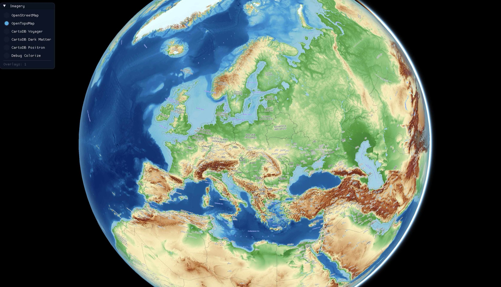
</p>

# VisuTwin Canvas

[](https://github.com/visutwin/visutwin-canvas/actions/workflows/ci.yml)
[](LICENSE)
[](https://en.cppreference.com/w/cpp/23)
[](FEATURES.md)
[](examples/README.md)
[](https://canvas.visutwin.com/?utm_source=github&utm_medium=readme)

**A native C++23 port of the [PlayCanvas](https://github.com/playcanvas/engine)
engine, extended for digital twins, geospatial scenes and scientific
visualization.** It runs on Apple Metal and Vulkan 1.3, and every shader is
written once in [Slang](https://shader-slang.org/) for both. It is a library
you link into your application: no browser, editor or scripting VM.

<p align="center">
  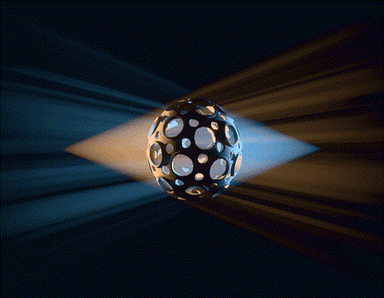
</p>

Beyond the PlayCanvas feature set it adds a Vulkan backend, volumetric fog, a
ray-traced lightmap baker, instanced wide lines and a Jolt physics backend. The
geospatial, scientific-visualization and robotics layers built on it have no
PlayCanvas equivalent.

> **Status: alpha.** The engine renders everything shown on this page and ships
> 105 working examples, all but one ported from PlayCanvas's own examples so the
> two can be compared side by side. The API is not stable and changes without
> notice. [FEATURES.md](FEATURES.md) lists what is implemented and the known gaps.

## Quick start

```bash
git clone https://github.com/visutwin/visutwin-canvas.git && cd visutwin-canvas
export VCPKG_ROOT=/path/to/vcpkg          # dependencies come from vcpkg
cmake --preset examples && cmake --build build-examples
open build-examples/examples/visutwin-post-processing.app
```

The first configure builds the dependencies through vcpkg, so it takes a while.
You need CMake 3.28+, Ninja, [vcpkg](https://vcpkg.io/) and a C++23 compiler
(Apple Clang from a current Xcode, or GCC 14). Run any example with
`VISUTWIN_BACKEND=vulkan` to switch backends without rebuilding.

| Platform | Engine | Examples | CI |
|---|---|---|---|
| macOS, Apple silicon, Metal | Yes | Yes | Build, unit tests, sanitizers |
| macOS, Apple silicon, Vulkan (MoltenVK) | Yes | Yes | Local validation and golden-image runs |
| Linux, Vulkan 1.3 | Yes | Not yet verified | Build and unit tests (GCC 14) |
| Windows | Not yet | No | No |

Vulkan needs a system loader: the [Vulkan SDK](https://vulkan.lunarg.com/) on
macOS, `libvulkan-dev` on Ubuntu.

## Examples

A few of the 161 examples, each a small self-contained program
([the full list](examples/README.md)):

| | | | |
|:---:|:---:|:---:|:---:|
| 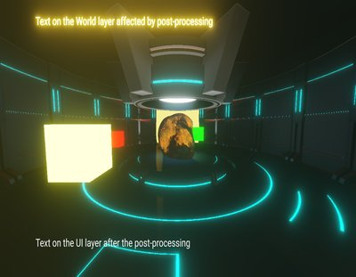<br>`post-processing` | 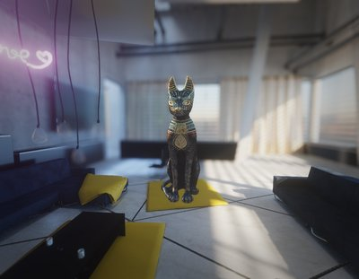<br>`depth-of-field` | 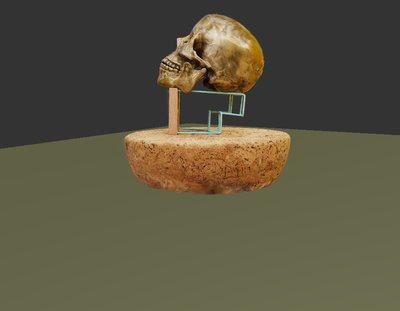<br>`gsplat-spherical-harmonics` | 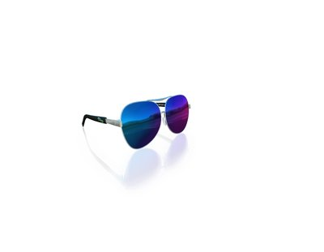<br>`reflection-planar-blurred` |
| 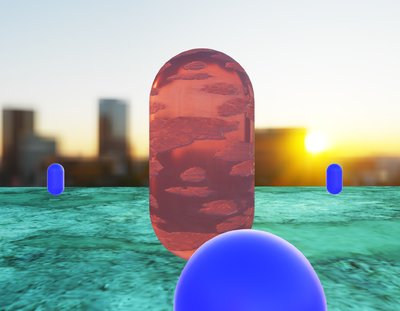<br>`refraction` | 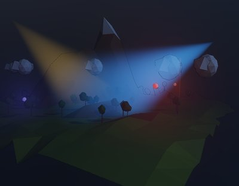<br>`volumetric-fog-local-lights` | 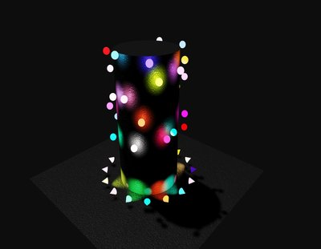<br>`clustered-lighting` | 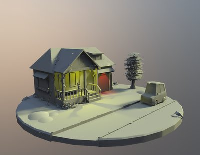<br>`lightmap-bake` |
| 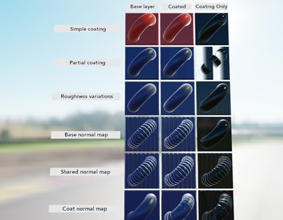<br>`clearcoat` | 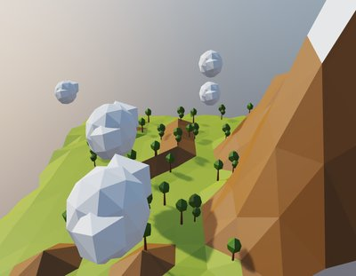<br>`shadow-cascades` | 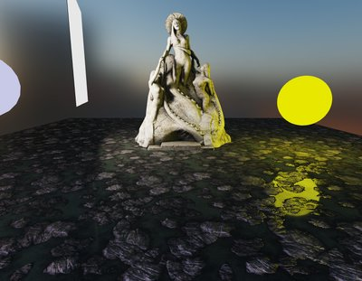<br>`area-light` | 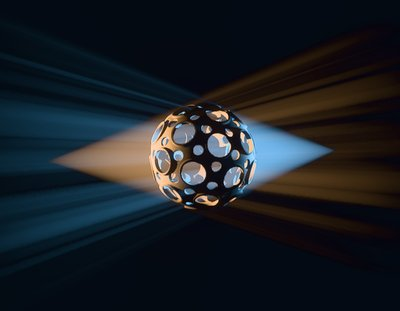<br>`volumetric-fog-shafts` |

## Built on VisuTwin Canvas

| | |
|---|---|
| 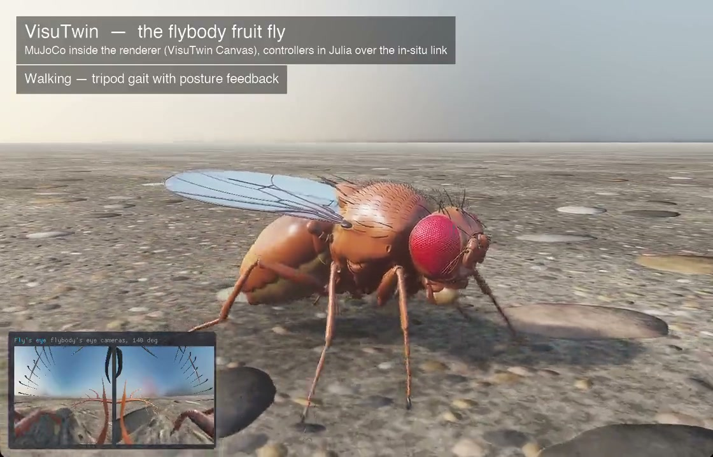 | **Biomechanics.** A fruit fly model walking, taking off and flying a ring, with MuJoCo physics running inside the renderer and controllers in Julia over an in-situ link. Built with `visutwin-robotics`. |
| 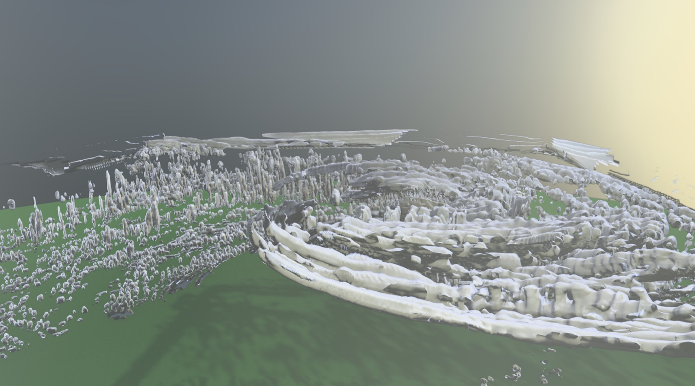 | **Volumetric scientific visualization.** Marching-cubes isosurfaces of the Hurricane Isabel dataset (IEEE Visualization 2004 contest data). Built with `visutwin-viz`. |
| 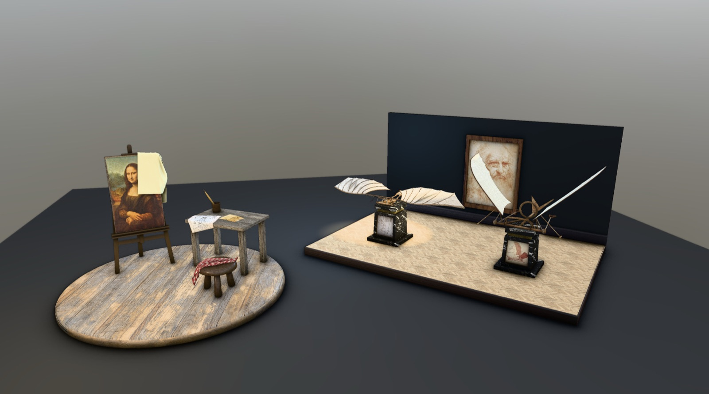 | **Physically based rendering.** Image-based lighting, soft shadows, and screen-space ambient occlusion — the `ambient-occlusion-davinci` example. |

The globe at the top is rendered with `visutwin-geo`
(WGS84 ellipsoid, 3D Tiles, terrain tiling, atmosphere) on top of this engine.
Imagery © [OpenStreetMap](https://www.openstreetmap.org/copyright) contributors
and [OpenTopoMap](https://opentopomap.org/) (CC-BY-SA).

## Why this exists

Most engines that render a planet do it in a browser, and most engines that
render a scientific volume are not real-time. VisuTwin Canvas is aimed at the
overlap:

- **Native and embeddable** — a C++ library you link into an application, not a
  runtime you ship a project into or a browser you render inside.
- **Physically based, without a game engine attached** — modern PBR, shadows,
  and post-processing without an editor or a scripting VM. Scripts are C++
  classes, and assets load from glTF/GLB, OBJ, STL, PLY and KTX2 files directly.
- **Built for instrumented scenes** — screen- and world-space UI, 3D-anchored
  labels, an ImGui/ImPlot overlay and immediate-mode debug rendering are
  first-class, because digital twins are mostly data drawn on top of geometry.
- **Deterministic time** — a fixed-timestep loop runs simulation substeps at a
  constant rate (`Script::fixedUpdate`), independent of the frame rate, and
  exposes an interpolation factor for smooth rendering in between. A coupled
  simulation and its visualization stay in step, and runs are reproducible.
- **Two backends, one shader source** — every engine shader is written once in
  Slang and compiled to Metal and SPIR-V, with shader features bound as
  function and specialization constants on both. Nine golden-image scenes are
  checked against reference images on each backend. A few paths are still
  Metal-only; FEATURES.md lists them.
- **Readable by design** — an established engine architecture ported
  deliberately, with deviations from PlayCanvas documented in the code.

## What's inside

- **Rendering:** forward PBR on a frame graph; StandardMaterial with clearcoat,
  sheen, iridescence, anisotropy, transmission and refraction, parallax and
  spec-gloss; image-based lighting, SH light probes and reflection probes;
  screen-space reflections; GPU instancing with GPU culling; dynamic batching;
  MSAA.
- **Lighting and shadows:** clustered lighting with a shadow atlas, LTC area
  lights, cascaded directional shadows (PCF, EVSM and PCSS), spot and omni
  shadows, light cookies, volumetric fog, and two lightmap bakers (GPU UV-space
  and CPU ray-traced).
- **Post-processing:** TAA, SSAO, bloom, multi-pass depth of field, colour
  grading and 3D LUTs, tone mapping, planar reflections, Nishita atmosphere.
- **Animation and simulation:** GPU skinning, morph targets, an animation state
  graph with blend trees and per-node layer blending, Gaussian splatting with
  spherical harmonics, GPU particles, and rigid bodies with joints through Jolt.
- **UI and input:** anchored elements, MSDF text with markup, buttons, masks,
  layout groups, scroll views and localization; keyboard, mouse, touch and
  gamepad devices fed from the application's event loop.

[FEATURES.md](FEATURES.md) has the full inventory and the known gaps.

## Using the engine in your project

The engine installs as a CMake package. Build and install it once:

```bash
cmake --preset release -B build-release -DVISUTWIN_CANVAS_SHARED=ON
cmake --build build-release
cmake --install build-release --prefix /path/to/prefix
```

Then link `visutwin::canvas` from your own project:

```cmake
find_package(VisuTwinCanvas CONFIG REQUIRED)
target_link_libraries(my-app PRIVATE visutwin::canvas)
```

Configure it with `-DCMAKE_PREFIX_PATH=/path/to/prefix`. The engine's
dependencies (SDL3, spdlog, assimp and the rest) must be findable too: use the
same vcpkg toolchain, or add the engine build's `vcpkg_installed/<triplet>`
directory to `CMAKE_PREFIX_PATH`.

A complete application, a lit box spinning on the Metal backend:

```cpp
#include <SDL3/SDL.h>

#include "framework/appOptions.h"
#include "framework/engine.h"
#include "framework/entity.h"
#include "framework/components/camera/cameraComponent.h"
#include "framework/components/camera/cameraComponentSystem.h"
#include "framework/components/light/lightComponent.h"
#include "framework/components/light/lightComponentSystem.h"
#include "framework/components/render/renderComponent.h"
#include "framework/components/render/renderComponentSystem.h"
#include "platform/graphics/graphicsDeviceCreate.h"
#include "scene/materials/standardMaterial.h"

using namespace visutwin::canvas;

int main()
{
    SDL_SetHint(SDL_HINT_RENDER_DRIVER, "metal");
    SDL_Init(SDL_INIT_VIDEO);
    SDL_Window* window = SDL_CreateWindow("Hello, Canvas", 1280, 720,
        SDL_WINDOW_METAL | SDL_WINDOW_HIGH_PIXEL_DENSITY | SDL_WINDOW_RESIZABLE);
    SDL_Renderer* renderer = SDL_CreateRenderer(window, nullptr);

    GraphicsDeviceOptions deviceOptions;
    deviceOptions.backend = Backend::Metal;
    deviceOptions.window = window;
    deviceOptions.swapChain = SDL_GetRenderMetalLayer(renderer);

    AppOptions options;
    options.graphicsDevice = createGraphicsDevice(deviceOptions);
    options.registerComponentSystem<RenderComponentSystem>();
    options.registerComponentSystem<CameraComponentSystem>();
    options.registerComponentSystem<LightComponentSystem>();

    auto engine = std::make_shared<Engine>(window);
    engine->init(options);
    engine->setCanvasFillMode(FillMode::FILLMODE_FILL_WINDOW);
    engine->setCanvasResolution(ResolutionMode::RESOLUTION_AUTO);
    engine->scene()->setAmbientLight(0.2f, 0.2f, 0.2f);

    auto material = std::make_shared<StandardMaterial>();
    material->setDiffuse(Color(0.8f, 0.3f, 0.2f, 1.0f));

    auto* box = new Entity();
    box->setEngine(engine.get());
    auto* render = static_cast<RenderComponent*>(box->addComponent<RenderComponent>());
    render->setMaterial(material.get());
    render->setType("box");
    engine->root()->addChild(box);

    auto* light = new Entity();
    light->setEngine(engine.get());
    light->addComponent<LightComponent>();  // directional, white, intensity 1
    light->setLocalEulerAngles(45.0f, 30.0f, 0.0f);
    engine->root()->addChild(light);

    auto* camera = new Entity();
    camera->setEngine(engine.get());
    camera->addComponent<CameraComponent>();
    camera->setLocalPosition(0.0f, 1.5f, 4.0f);
    camera->setLocalEulerAngles(-20.0f, 0.0f, 0.0f);
    engine->root()->addChild(camera);

    engine->start();

    Uint64 previous = SDL_GetTicksNS();
    for (bool running = true; running;) {
        for (SDL_Event event; SDL_PollEvent(&event);) {
            running &= event.type != SDL_EVENT_QUIT;
        }
        const Uint64 now = SDL_GetTicksNS();
        const float dt = static_cast<float>(now - previous) * 1e-9f;
        previous = now;

        box->rotate(0.0f, 30.0f * dt, 0.0f);
        engine->update(dt);
        engine->render();
    }

    engine.reset();
    SDL_DestroyRenderer(renderer);
    SDL_DestroyWindow(window);
    SDL_Quit();
}
```

The Vulkan backend creates its own swap chain from the window instead (an
`SDL_WINDOW_VULKAN` window, no SDL renderer); `examples/exampleApp.cpp` sets up
either backend, plus input devices and camera controls.

## Building and testing

```bash
cmake --preset default
cmake --build --preset default
ctest --preset default
```

| Preset | Builds |
|---|---|
| `default` | Debug, Metal (`build/`) |
| `release` | Release |
| `examples` | Debug with every example (`build-examples/`) |
| `vulkan` | Debug, Vulkan (`build-vulkan/`) |
| `sanitize` | Debug under AddressSanitizer and UndefinedBehaviorSanitizer (`build-sanitize/`) |

The backends can also be chosen explicitly with `VISUTWIN_BACKEND_METAL=ON|OFF`
and `VISUTWIN_BACKEND_VULKAN=ON|OFF`; at least one must be on.

Any application built on the engine honours `VISUTWIN_BACKEND` (`metal` or
`vulkan`) and `VISUTWIN_SCREENSHOT` (write a PNG of the back buffer, with
`VISUTWIN_SCREENSHOT_FRAME`, `_TIME` or `_COUNT` choosing when and how many),
so an application can be switched or captured without recompiling. The examples
add their own measurement hooks — `VISUTWIN_FIXED_DT` for deterministic
animation, `VISUTWIN_MAX_PIXEL_RATIO`, `VISUTWIN_CPU_STATS` and others — listed
in [AGENTS.md](AGENTS.md).

`ctest --preset default` runs the unit tests (also under the `sanitize` and
`vulkan` presets). Two GPU suites need a window and run locally:
`ctest --preset vulkan-smoke` runs the Vulkan backend under the validation
layers, and `ctest --preset golden` compares nine deterministic examples against
reference images. CI builds the Metal preset with every example, runs the unit
tests on macOS (also under the sanitizers) and on Linux with Vulkan, and checks
the SIMD math on each backend.

<details>
<summary>Sharing metal-cpp with other VisuTwin projects</summary>

The Metal backend uses Apple's header-only metal-cpp, carried in
`engine/lib/metal-cpp` and installed to
`<prefix>/include/visutwin/canvas-metal-cpp` for downstream consumers. This is
the authoritative copy for the VisuTwin projects; `visutwin-sim` keeps a
fallback so it builds on its own and is normally pointed here instead:

```bash
cmake -S . -B build -DVISUTWIN_SIM_ENABLE_METAL=ON \
  -DVISUTWIN_SIM_METAL_CPP_DIR=../visutwin-canvas/engine/lib/metal-cpp
```

`VISUTWIN_CANVAS_METAL_CPP_DIR` does the same for this project, so the shared
copy can live anywhere. Keep the copies in step when upgrading; nothing checks
that automatically.

</details>

## Docs

- [FEATURES.md](FEATURES.md) — full feature inventory and per-module status
- [examples/](examples/README.md) — the examples, grouped and described
- [CONTRIBUTING.md](CONTRIBUTING.md) — layout, tests, and shader workflow
- [ARCHITECTURE.md](ARCHITECTURE.md) — how each subsystem works and where it deviates from upstream
- [AGENTS.md](AGENTS.md) — the rules, contracts and known traps for anyone changing the code
- [canvas.visutwin.com](https://canvas.visutwin.com/?utm_source=github&utm_medium=readme) — project home page

## Related projects

Separate CMake projects built on this engine, to be published soon:

- **visutwin-geo** — WGS84 ellipsoid, 3D Tiles, terrain tiling, globe camera, atmosphere
- **visutwin-viz** — volume loading, marching cubes, streamlines, transfer
  functions, and the in-situ transport that couples a running simulation to the renderer
- **visutwin-robotics** — URDF and MuJoCo pipelines for robot and biomechanics
  visualization

## Attribution

VisuTwin Canvas derives its architecture, class hierarchy, and core rendering
algorithms from the [PlayCanvas engine](https://github.com/playcanvas/engine),
used under the MIT License. Work built on that foundation — the Vulkan backend,
volumetric fog, the CPU lightmap baker, the physics integration, and the
geospatial and scientific-visualization layers — is original and licensed under
Apache-2.0. Deviations from upstream behaviour are marked with `DEVIATION:`
comments in the source. See [NOTICE](NOTICE) for full attribution.

## Citing

If you use VisuTwin Canvas in research, please cite it. GitHub's "Cite this
repository" button gives the reference from [CITATION.cff](CITATION.cff).

## License

Licensed under the Apache License, Version 2.0. See [LICENSE](LICENSE).
